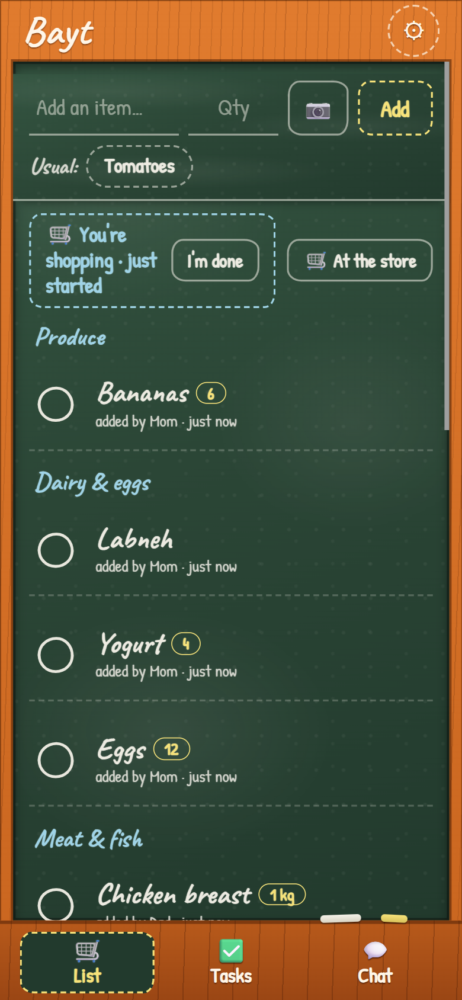
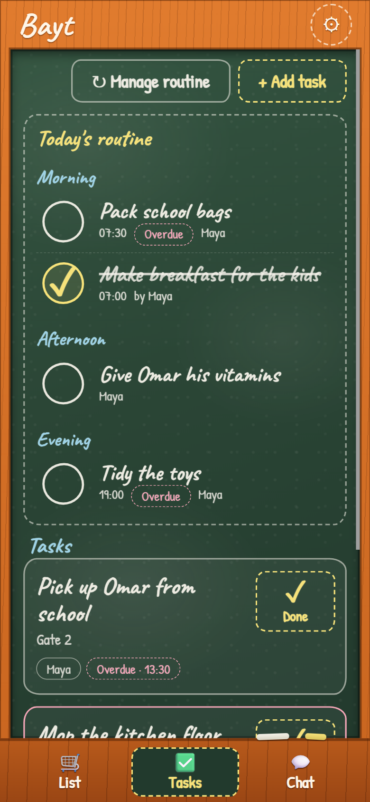
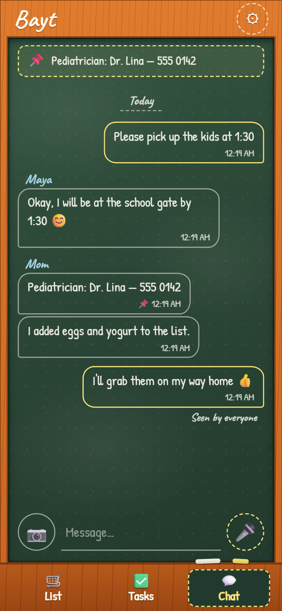
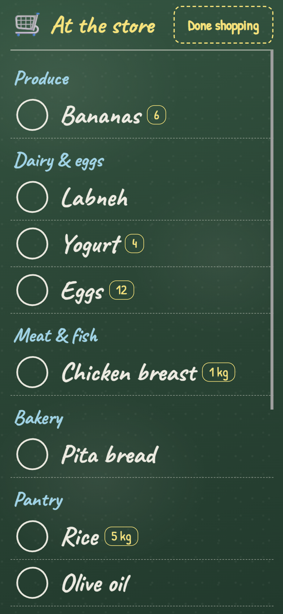
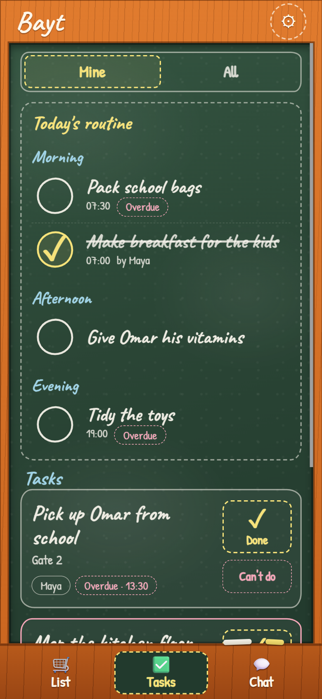
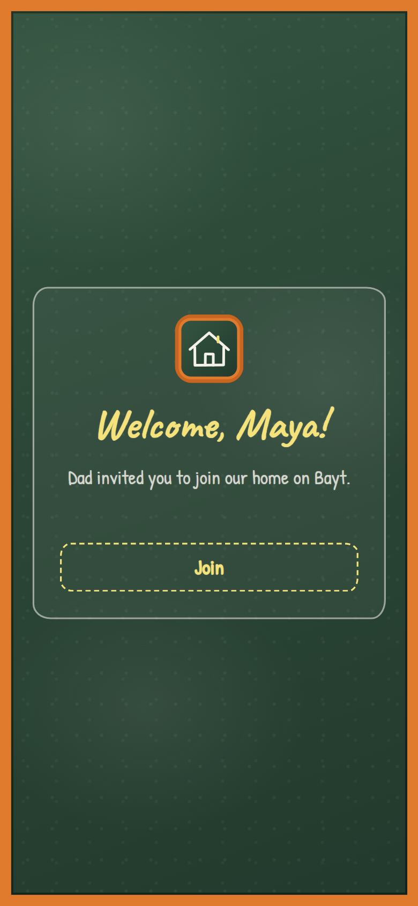

# Bayt — a private family app for the shopping list, the house chores and the family chat

**Bayt** (Arabic for *home*) is a small, self-hosted Progressive Web App for one household: the
parents and the person who helps them at home (a nanny, housekeeper or grandparent). It replaces
the endless WhatsApp messages with three shared screens — a **shopping list**, a **task board**
and a **family chat** — that update live on everyone's phone, work offline, and send push
notifications.

It runs entirely on Cloudflare's free tier (Workers, D1, R2, Durable Objects). No accounts, no
passwords, no ads, no tracking: you host it, your family's data stays in your Cloudflare account.

<p align="center">
  
  
  
</p>
<p align="center">
  
  
  
</p>

## Features

**Shopping list**
- Anyone adds items; they are grouped by aisle automatically (Produce, Dairy & eggs, Meat & fish,
  Bakery, Pantry, Baby, Cleaning, …) and can be moved to another aisle by hand.
- Ticking an item strikes it through and moves it to *Bought*, with **Undo**; bought items
  disappear from the list after 48 hours.
- **"At the store" mode**: a full-screen, big-tick checklist that keeps the screen awake, and an
  optional "Dad is shopping now" banner (with a push) so nobody buys the same things twice.
- One-tap **usual items** (milk, bread, diapers…), autocomplete, and an optional **photo** of
  the exact product.

**Tasks**
- Parents create and assign tasks; the helper sees what to do and ticks them off.
- **Repeating tasks** (every day, every N days, chosen weekdays), **due time** with a push
  **reminder 15 minutes before**.
- **Today's routine** checklist grouped into Morning / Afternoon / Evening.
- Optional **photo when done**, and **"Can't do"** with a reason ("Out of supplies") that can add
  the missing item straight to the shopping list and notifies the parents.

**Chat**
- One family conversation with **photos** and **voice notes**, **"Seen by …"** receipts,
  **pinned messages** (doctor's number, allergies), and long-press to turn any message into a
  task or a shopping item.

**Everywhere**
- Live sync between phones (WebSockets through a Durable Object), web push notifications.
- **Works offline**: the last data stays readable and new items, ticks and messages are queued
  and sent when the connection returns.
- Installable from Chrome (Android) or Safari (iPhone); an optional Android APK wrapper is
  included.
- Respectful by design: invites carry the person's name, so nobody is labelled by a role, and
  helpers can't rename themselves.

## How sign-in works

There are no passwords. The first parent opens the app once with a secret **setup code** and
types their name. Everyone else joins through a **one-time invite link** (valid 24 hours) that
already contains their name — they just tap **Join**. Each phone keeps a random device token;
the server stores only its SHA-256 hash. A parent can remove a member at any time, which signs
that phone out immediately. The household is capped at 3 members by default
(`MAX_MEMBERS` in `src/lib/auth.ts`).

## Tech stack

| Part | Choice |
| --- | --- |
| Server | Cloudflare Worker + [Hono](https://hono.dev), TypeScript |
| Data | D1 (SQLite) with SQL migrations, R2 for photos and voice notes |
| Realtime + reminders | One `Household` Durable Object (hibernating WebSockets, alarms) |
| Push | Dependency-free VAPID Web Push, content-free payloads |
| Client | Vanilla TypeScript, Vite, [vite-plugin-pwa](https://vite-pwa-org.netlify.app) (Workbox) |
| Tests | Vitest with `@cloudflare/vitest-plugin` |

## Run it locally

```sh
npm install
cp .dev.vars.example .dev.vars        # sets a local SETUP_CODE
npx wrangler d1 migrations apply bayt --local
npm run dev                           # http://localhost:8787
```

## Deploy your own (about 10 minutes)

You need a free Cloudflare account and `npx wrangler login`.

1. Create the database and storage:
   ```sh
   npx wrangler d1 create bayt          # paste the returned database_id into wrangler.jsonc
   npx wrangler r2 bucket create bayt-media
   ```
2. Choose your secret setup code (you'll type it once on your phone):
   ```sh
   npx wrangler secret put SETUP_CODE
   ```
3. Set `VAPID_SUBJECT` in `src/lib/push.ts` to your app's URL or a `mailto:` address.
4. Create the tables and deploy:
   ```sh
   npx wrangler d1 migrations apply bayt --remote
   npm run deploy
   ```
5. On your phone, open the `https://bayt.<your-subdomain>.workers.dev` address, enter the setup
   code and your name, install the app from the browser menu, and turn on notifications in
   ⚙️ Settings. Invite the others from **Settings → Invite someone**.

> On Windows PowerShell, if `npx` is blocked by the execution policy, use `npx.cmd` instead.

### Continuous deployment (optional)

`.github/workflows/deploy.yml` runs typecheck, tests and build on every push. To deploy on every
push to `main`, pick **one** of these (not both, or each push deploys twice):

- **Cloudflare Workers Builds** (no token to manage): in the dashboard, open the Worker →
  **Settings → Builds → Connect**, choose the repository and branch `main`, and set
  - Build command: `npm run build`
  - Deploy command: `npx wrangler d1 migrations apply bayt --remote && npx wrangler deploy`
- **GitHub Actions**: add the repository secrets `CLOUDFLARE_API_TOKEN` and
  `CLOUDFLARE_ACCOUNT_ID` and the repository variable `DEPLOY_ENABLED=true`.

Either way, the GitHub run's "success" alone does not mean a deploy happened; check the
deploy job (or the Cloudflare build) actually ran.

## Android APK (optional)

An Android wrapper (Trusted Web Activity) for phones that can't install the PWA is in
[`android/`](android/README.md). The signed APK is built locally into `releases/`; signing keys
stay in the git-ignored `android/signing/`. Deploy `public/.well-known/assetlinks.json` with the
site for full-screen verification, and change the package name and fingerprint if you fork.

## Project layout

```
src/            Worker: routes (auth, items, tasks, messages, media, push, live), Durable Object, libs
web/            PWA client: views (list, tasks, chat, settings), service worker, offline outbox
migrations/     D1 schema
test/           Vitest suites (run with npm test)
public/         Icons, security headers (_headers), asset links
android/        Optional Android wrapper
```

## Privacy and security

- Strict Content-Security-Policy, no third-party scripts; fonts from Google Fonts only.
- Push notifications carry no content — the phone fetches the text from your server.
- Media is served only to household members; unattached uploads are cleaned up daily.
- Bought items, done tasks and old messages are pruned automatically (see `src/lib/cleanup.ts`).

## Credits

- Realtime and rate-limit patterns inspired by
  [cloudflare/workers-chat-demo](https://github.com/cloudflare/workers-chat-demo) (BSD-3-Clause).
- [vite-plugin-pwa](https://github.com/vite-pwa/vite-plugin-pwa) and Workbox (MIT).
- UX ideas (no code) from [KitchenOwl](https://github.com/TomBursch/kitchenowl) and
  [Donetick](https://github.com/donetick/donetick).

## License

[MIT](LICENSE). The Android wrapper template in `android/` is under its own Apache-2.0 license.
